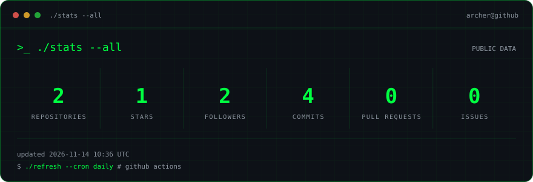
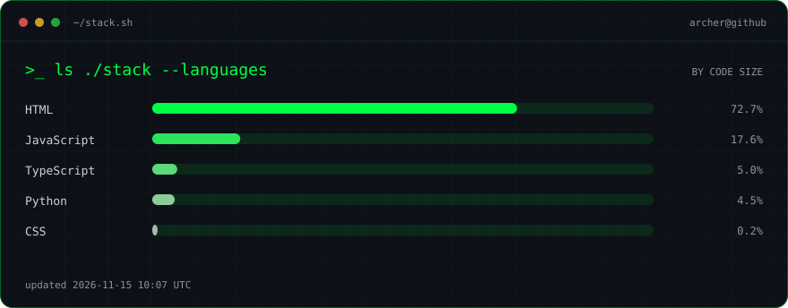

<div align="center">


<br/><br/>

<a href="https://t.me/teleroot"></a>
<a href="https://teleroot-io.github.io/telesite/"></a>


</div>

<br/>

```console
archer@github:~$ ./whoami.sh

  user      Archer
  role      разработчик
  focus     Telegram-боты · автоматизация · backend
  stack     Python · aiogram · Node.js · SQLite · Docker
  env       Linux · VPS · systemd · nginx · Git
  site      teleroot-io.github.io/telesite
  telegram  @teleroot
```

## `>_ cat about.md`

Пишу Telegram-ботов и сервисную автоматизацию: от сценариев на **aiogram** до деплоя в **Docker** на Linux-сервере. Разбираюсь в чужих проектах быстро и не привязываюсь к одному языку — Python там, где важна скорость разработки, Node.js там, где он уместнее.

Люблю терминал, тёмные интерфейсы и вещи, которые решают конкретную задачу. Всё, что ниже, — рабочий код, а не демо на скриншотах.

## `>_ ls ./stack`

**Языки**


**Боты и данные**


**Инфраструктура**


## `>_ ./stats --all`

<div align="center">






</div>

## `>_ ls /projects`

**`telesite`** — терминальный сайт-визитка: ASCII-интерфейс, переключение цветовых схем и живой «system monitor» на чистом JS.

`JavaScript` · `CSS` · `HTML` · ★ 1

[`./open_site`](https://teleroot-io.github.io/telesite/) · [`./source`](https://github.com/teleroot-io/telesite)

Остальные проекты — Telegram-боты, парсеры и внутренняя автоматизация — живут в приватных репозиториях.

## `>_ cat contacts.txt`

```console
archer@github:~$ cat contacts.txt
telegram   https://t.me/teleroot
website    https://teleroot-io.github.io/telesite/
```

<div align="center">

<a href="https://t.me/teleroot"></a>

<br/><br/>

<sub><code>ACCESS GRANTED</code> · Yuuki System is ready for your commands 🖤🐾</sub>

</div>
